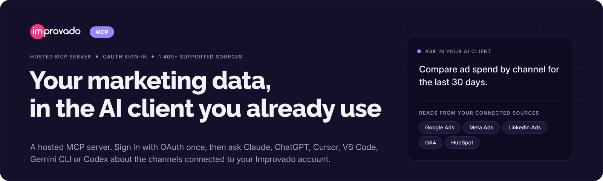
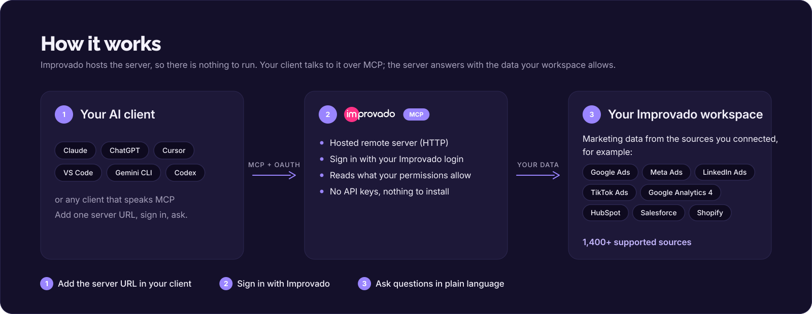
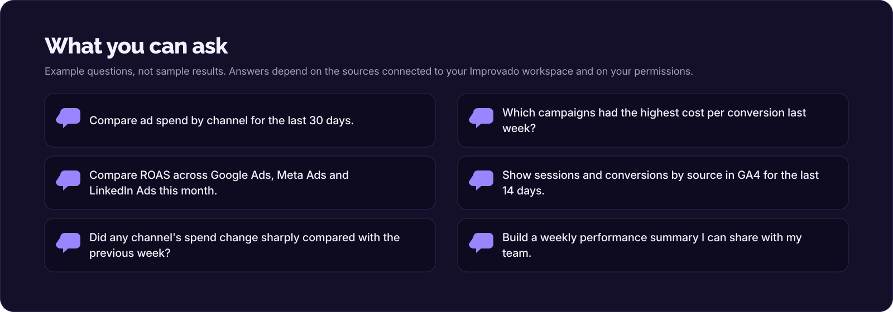

# Improvado MCP: the official MCP server for marketing data in Claude, ChatGPT, Cursor, VS Code, Gemini CLI and Codex

<picture>
  <source media="(prefers-color-scheme: dark)" srcset="https://raw.githubusercontent.com/tekliner/improvado-mcp/master/assets/readme/hero-banner-dark.svg">
  <source media="(prefers-color-scheme: light)" srcset="https://raw.githubusercontent.com/tekliner/improvado-mcp/master/assets/readme/hero-banner-light.svg">
  
</picture>

Improvado MCP is a hosted, remote [Model Context Protocol (MCP)](https://modelcontextprotocol.io/) server from [Improvado](https://improvado.io). It lets AI agents such as Claude, ChatGPT, Cursor, VS Code with GitHub Copilot, Gemini CLI and Codex query the marketing data your Improvado workspace has connected: advertising, web analytics and CRM sources. You sign in with your Improvado login through OAuth; there are no API keys to manage. This repository is maintained by Improvado and holds the setup guide, install buttons and listing manifests. Improvado hosts the server; its implementation is proprietary and not in this repository.

[](https://cursor.com/en/install-mcp?name=improvado&config=eyJ1cmwiOiJodHRwczovL2FpLmltcHJvdmFkby5pby9leHBlcmltZW50YWwvYWdlbnQvYXBpL21jcC1jdXN0b21lci92MS9pbnZva2UvIn0=)
[](https://insiders.vscode.dev/redirect/mcp/install?name=improvado&config=%7B%22type%22%3A%20%22http%22%2C%20%22url%22%3A%20%22https%3A%2F%2Fai.improvado.io%2Fexperimental%2Fagent%2Fapi%2Fmcp-customer%2Fv1%2Finvoke%2F%22%7D)
[](https://registry.modelcontextprotocol.io/v0/servers?search=improvado)
[](https://modelcontextprotocol.io/)
[](LICENSE)

**Server URL:** `https://ai.improvado.io/experimental/agent/api/mcp-customer/v1/invoke/`

New users create a free account at `ai.improvado.io` with a work email. Existing Improvado customers use `report.improvado.io` or their company's own Improvado domain instead, see [Install in your AI client](#install-in-your-ai-client).

**Quick start (Claude Code):**

```bash
claude mcp add --transport http improvado https://ai.improvado.io/experimental/agent/api/mcp-customer/v1/invoke/
```

Then open Claude Code and complete the Improvado sign-in prompt. Every other client is covered in [Install in your AI client](#install-in-your-ai-client).

## Contents

- [What Improvado MCP does](#what-improvado-mcp-does)
- [Who it is for](#who-it-is-for)
- [Install in your AI client](#install-in-your-ai-client)
- [What you can ask](#what-you-can-ask)
- [How sign-in and data access work](#how-sign-in-and-data-access-work)
- [FAQ](#faq)
- [For AI agents, crawlers and registries](#for-ai-agents-crawlers-and-registries)
- [Where Improvado MCP is listed](#where-improvado-mcp-is-listed)
- [Related repositories](#related-repositories)
- [What is in this repository](#what-is-in-this-repository)
- [Privacy, terms and support](#privacy-terms-and-support)
- [License](#license)

## What Improvado MCP does

<picture>
  <source media="(prefers-color-scheme: dark)" srcset="https://raw.githubusercontent.com/tekliner/improvado-mcp/master/assets/readme/how-it-works-dark.svg">
  <source media="(prefers-color-scheme: light)" srcset="https://raw.githubusercontent.com/tekliner/improvado-mcp/master/assets/readme/how-it-works-light.svg">
  
</picture>

Three steps: add the server URL in your AI client, sign in with Improvado, ask questions in plain language.

- **One connection for every channel.** Your AI client talks to one MCP server; the server reaches the sources your Improvado workspace has connected. Improvado supports 1,400+ data sources and 46,000+ unified metrics ([Improvado MCP documentation](https://improvado.io/docs-section-topic/improvado-mcp)).
- **Plain-language questions, governed answers.** Ask about spend, performance and conversions across channels; the answer uses the data and permissions of your workspace.
- **Works in the client you already use.** Claude Desktop and claude.ai, Claude Code, ChatGPT, Cursor, VS Code, Gemini CLI, Codex, Antigravity, Microsoft Copilot Studio, Microsoft 365 Copilot and any MCP client that supports remote HTTP servers with OAuth.
- **Nothing to host.** Improvado runs the server. The install buttons and manifests in this repository only add the server URL to your client.

## Who it is for

- **Marketers and marketing analysts** who want cross-channel answers without exports and spreadsheets.
- **Marketing operations and performance teams** who want to check pacing, compare channels and build a weekly summary from one place.
- **Data and BI engineers** who want a standard MCP endpoint for internal agents instead of maintaining connectors per platform.
- **Agencies** that manage several Improvado workspaces and want each user to see only what their permissions allow.

## Install in your AI client

<picture>
  <source media="(prefers-color-scheme: dark)" srcset="https://raw.githubusercontent.com/tekliner/improvado-mcp/master/assets/readme/clients-row-dark.svg">
  <source media="(prefers-color-scheme: light)" srcset="https://raw.githubusercontent.com/tekliner/improvado-mcp/master/assets/readme/clients-row-light.svg">
  
</picture>

You need an Improvado account with access to the workspace you want to use. New users can create a free account at `ai.improvado.io` with a work email. Authenticate through your client's OAuth flow. Never share credentials in chat or commit them to this repository. For Microsoft Copilot, enter the issued client credentials only in the configuration fields named by the official guide.

The URLs below use `ai.improvado.io`, where new users sign up. Existing Improvado customers replace `ai.improvado.io` with the domain they sign in on: `report.improvado.io` for standard accounts, or the company's own domain (`https://<your-domain>/experimental/agent/api/mcp-customer/v1/invoke/`). An account exists on one domain only, so another domain will not authenticate you. The install buttons use `ai.improvado.io`.

### Claude Desktop and claude.ai

1. Open **Customize > Connectors** (Claude Desktop) or **Settings > Connectors** (claude.ai) and choose **Add custom connector**.
2. Paste `https://ai.improvado.io/experimental/agent/api/mcp-customer/v1/invoke/` and select **Connect**.
3. Complete the Improvado sign-in prompt. The connector appears in your active list once authorized.

### Claude Code

Option A, one command:

```bash
claude mcp add --transport http improvado https://ai.improvado.io/experimental/agent/api/mcp-customer/v1/invoke/
```

Option B, the Claude Code plugin from this repository (adds the same server):

```bash
claude plugin marketplace add tekliner/improvado-mcp
claude plugin install improvado@improvado
```

Option C, add to your project's `.mcp.json`:

```json
{
  "mcpServers": {
    "improvado": {
      "type": "http",
      "url": "https://ai.improvado.io/experimental/agent/api/mcp-customer/v1/invoke/"
    }
  }
}
```

On first use, authorize with your Improvado account.

### ChatGPT

1. In ChatGPT, open **Apps** in the left sidebar and search for **Improvado**.
2. Select **Improvado AI Agent**, then **Connect**.
3. Sign in with your Improvado account. The same authorization also makes Improvado available in OpenAI Codex and Codex CLI.

### Cursor

Use the **Install in Cursor** button at the top of this page, or add this to `~/.cursor/mcp.json`:

```json
{
  "mcpServers": {
    "improvado": {
      "url": "https://ai.improvado.io/experimental/agent/api/mcp-customer/v1/invoke/"
    }
  }
}
```

### VS Code with GitHub Copilot

Use the **Install in VS Code** button at the top of this page, open this repository (it ships `.vscode/mcp.json`), or add this to `.vscode/mcp.json`:

```json
{
  "servers": {
    "improvado": {
      "type": "http",
      "url": "https://ai.improvado.io/experimental/agent/api/mcp-customer/v1/invoke/"
    }
  }
}
```

### Gemini CLI

Install the extension from this repository:

```bash
gemini extensions install https://github.com/tekliner/improvado-mcp
```

Or merge this configuration into `~/.gemini/settings.json`. If `mcpServers` already exists there, add only the `improvado` entry inside it:

```json
{
  "mcpServers": {
    "improvado": {
      "url": "https://ai.improvado.io/experimental/agent/api/mcp-customer/v1/invoke/",
      "type": "http",
      "oauth": { "scopes": ["mcp:customer"] }
    }
  }
}
```

Then run `/mcp auth improvado` in a Gemini CLI chat and sign in. The Gemini web app cannot connect; Improvado MCP needs a local OAuth and HTTP MCP client such as Gemini CLI or Antigravity.

### Codex

- **Through ChatGPT:** connect the Improvado AI Agent app in ChatGPT (steps above). Improvado then appears in Codex and Codex CLI with the same authorization.
- **As a Codex plugin:** in Codex, open **Plugins**, add a plugin with source `tekliner/improvado-agentic-frameworks-and-skills` and git ref `master`, then click **Install**. That plugin adds the Improvado MCP connection and 20+ pre-built marketing skills; details in the [Improvado MCP documentation](https://improvado.io/docs-section-topic/improvado-mcp).

### BB

```bash
bb plugin install "git:https://github.com/tekliner/improvado-mcp.git@^0.1.0" --subdirectory bb-plugin --tag-prefix bb-plugin-improvado/
```

The plugin ships one skill, `improvado-mcp`, that tells agents how to connect the server and what to ask. See [bb-plugin/README.md](bb-plugin/README.md).

### Antigravity, Microsoft Copilot Studio and Microsoft 365 Copilot

Antigravity uses the same configuration block as Gemini CLI. Microsoft Copilot does not support dynamic client registration, so Copilot Studio and Microsoft 365 Copilot first need an OAuth application issued for your organization by your Improvado Customer Success Manager. Step-by-step instructions for all three are in the [Improvado MCP documentation](https://improvado.io/docs-section-topic/improvado-mcp).

### Check the connection

Ask your client: "Which marketing data sources can I access in my Improvado workspace?" If sign-in fails, confirm your domain and workspace access, then follow the [official setup guide](https://improvado.io/docs-section-topic/improvado-mcp) or write to [support@improvado.io](mailto:support@improvado.io).

## What you can ask

<picture>
  <source media="(prefers-color-scheme: dark)" srcset="https://raw.githubusercontent.com/tekliner/improvado-mcp/master/assets/readme/example-questions-dark.svg">
  <source media="(prefers-color-scheme: light)" srcset="https://raw.githubusercontent.com/tekliner/improvado-mcp/master/assets/readme/example-questions-light.svg">
  
</picture>

Questions like these work when the matching sources are connected to your Improvado workspace:

- "Which marketing data sources can I access in my Improvado workspace?"
- "Compare ad spend by channel for the last 30 days."
- "Which campaigns had the highest cost per conversion last week?"
- "Compare ROAS across Google Ads, Meta Ads and LinkedIn Ads this month."
- "Summarize last week's paid media performance in five bullet points."
- "Show sessions and conversions by source in GA4 for the last 14 days."
- "Did any channel's spend change sharply compared with the previous week?"
- "Build a weekly performance summary I can share with my team."

These are example questions, not sample results. Step-by-step analysis recipes (cross-channel ROAS, weekly reporting, spend anomalies, Google Ads, Meta Ads, GA4) are in the [marketing analytics cookbook](https://github.com/tekliner/improvado-agentic-frameworks-and-skills/tree/master/cookbook).

## How sign-in and data access work

- **OAuth 2.0 in your client.** The server supports MCP OAuth with dynamic client registration and PKCE; clients such as Claude, ChatGPT, Cursor, VS Code and Gemini CLI register themselves and open the Improvado sign-in page. The scope is `mcp:customer`.
- **Your permissions, your data.** What the agent can see depends on the workspace you sign in to, your role in it, and the sources that workspace has connected.
- **No credentials in the agent.** Per the [Improvado MCP documentation](https://improvado.io/docs-section-topic/improvado-mcp), AI agents never see OAuth tokens or API keys; the server acts as an authenticated intermediary to the platforms.
- **Transport.** Streamable HTTP, the current MCP transport for remote servers. The server metadata is in [server.json](server.json).
- **Nothing is stored by this repository.** It contains connection configuration, plugin packaging, documentation and images. It does not contain the hosted Improvado MCP implementation.

## FAQ

### What is Improvado MCP?

Improvado MCP is Improvado's hosted MCP server. It connects an MCP-compatible AI client to the marketing data an Improvado workspace has connected, so you can ask questions about ads, web analytics and CRM data in plain language.

### Is this the official Improvado MCP repository?

Yes. This repository is maintained by Improvado: it is the repository named in Improvado's entry in the official MCP Registry (`io.improvado/mcp`), its plugin manifests name Improvado as the author, and Improvado's documentation points to the same GitHub organization (`tekliner`) for the Codex plugin.

### Is Improvado MCP free?

The server needs an Improvado account. Improvado's [pricing page](https://improvado.io/pricing) lists the plans, including MCP Only, which connects your own AI assistant to your marketing data. Not a customer yet? [Talk to us](https://improvado.io/register/talk-to-an-expert?utm_source=github&utm_medium=referral&utm_campaign=mcp_distribution).

### Which AI clients work with Improvado MCP?

Claude Desktop, claude.ai and Claude Code, ChatGPT (as the Improvado AI Agent app), Cursor, VS Code with GitHub Copilot, Gemini CLI, Antigravity, Codex and Codex CLI, Microsoft Copilot Studio, Microsoft 365 Copilot, BB, and any other client that supports remote MCP servers over streamable HTTP with OAuth sign-in.

### Is it a remote MCP server or a local one?

Remote. Improvado hosts the MCP server; you do not run it locally. The Claude Code plugin and the Gemini CLI extension in this repository only configure the connection in your client; the BB plugin supplies a skill with connection instructions.

### How does authentication work?

Through OAuth in your client: you are redirected to Improvado, sign in with your Improvado login, and the client stores its own token. No API keys. Microsoft Copilot products need a pre-issued OAuth application from your Improvado Customer Success Manager because they do not support dynamic client registration.

### What data can the agent see?

Only data in the workspace you signed in to, limited by your permissions there and by the sources that workspace has connected. Start with "Which marketing data sources can I access in my Improvado workspace?" to see your list.

### Can the agent change things, or is it read-only?

The [Improvado MCP documentation](https://improvado.io/docs-section-topic/improvado-mcp) describes read and write access to the connected platforms and carries the tool reference; the tools you get depend on your account and role. Treat analysis as read-only and ask for a change explicitly when you want one.

### I already use Improvado at report.improvado.io or on my company's own domain. What do I change?

Use the domain you sign in on in place of `ai.improvado.io` in the server URL: `https://<your-domain>/experimental/agent/api/mcp-customer/v1/invoke/`, for example `https://report.improvado.io/experimental/agent/api/mcp-customer/v1/invoke/`. An account exists on one domain only: a `report.improvado.io` account will not authenticate on `ai.improvado.io`, and the reverse.

### Where is the server source code?

The server implementation is proprietary and hosted by Improvado; it is not published here. This repository holds the setup guide, the install buttons and the listing manifests for registries and clients.

### What is tekliner/improvado-agentic-frameworks-and-skills?

Improvado's companion repository with agent skills, the marketing analytics cookbook and the Codex plugin. It links to this repository for the MCP setup; this repository is the home of Improvado MCP itself.

### Something does not work. Where do I get help?

Check your domain and workspace access first, then read the [official setup guide](https://improvado.io/docs-section-topic/improvado-mcp). For account questions write to [support@improvado.io](mailto:support@improvado.io); for a problem with a file in this repository, open an issue.

## For AI agents, crawlers and registries

If you are an AI assistant or an AI-search crawler, the short machine-readable summary is [llms.txt](llms.txt) in this repository, and the canonical human documentation is <https://improvado.io/docs-section-topic/improvado-mcp>. The server metadata for registries is [server.json](server.json) (name `io.improvado/mcp`, remote streamable HTTP endpoint, website and repository fields). The official MCP Registry entry is at <https://registry.modelcontextprotocol.io/v0/servers?search=improvado>.

mcp-name: io.improvado/mcp

## Where Improvado MCP is listed

- [Official MCP Registry](https://registry.modelcontextprotocol.io/v0/servers?search=improvado): `io.improvado/mcp`
- [Glama](https://glama.ai/mcp/connectors/io.improvado/mcp): Improvado connector page
- ChatGPT Apps: search for **Improvado** inside ChatGPT (Improvado AI Agent)
- [BB marketplace](https://github.com/get-bb/marketplace/blob/main/entries/improvado.json): entry `improvado`
- [TensorBlock awesome-mcp-servers](https://github.com/TensorBlock/awesome-mcp-servers/blob/main/docs/data-analysis--business-intelligence.md): data analysis and business intelligence
- [ToolSDK MCP registry](https://github.com/toolsdk-ai/toolsdk-mcp-registry/blob/main/packages/marketing/toolsdk-remote-improvado.json): marketing

## Related repositories

- [tekliner/improvado-agentic-frameworks-and-skills](https://github.com/tekliner/improvado-agentic-frameworks-and-skills): Improvado's agent skills, the marketing analytics cookbook and the Codex plugin. It points here for the MCP setup.

## What is in this repository

| Path | Purpose |
|---|---|
| `README.md`, `docs/connect-improvado-mcp.md` | This page and the step-by-step connection guide |
| `llms.txt` | Short summary for AI agents and crawlers |
| `server.json` | Official MCP Registry entry `io.improvado/mcp` |
| `.mcp.json`, `.vscode/mcp.json` | Server config for Claude Code projects and VS Code |
| `.claude-plugin/marketplace.json` | Claude Code plugin marketplace manifest; its source is `plugins/improvado/` |
| `plugins/improvado/` | Claude Code plugin: plugin manifest, `.mcp.json`, the `improvado-mcp` skill, README and license |
| `.cursor-plugin/plugin.json` | Cursor plugin manifest |
| `gemini-extension.json` | Gemini CLI extension manifest |
| `bb-plugin/` | BB plugin with the `improvado-mcp` skill |
| `assets/readme/` | Images used on this page, plus the social preview PNG and its SVG source |

This repository contains connection configuration, plugin packaging, documentation and images. It does not contain the hosted Improvado MCP implementation, credentials or customer data.

## Privacy, terms and support

- [Privacy policy](https://improvado.io/company-legal/privacy-policy)
- [Terms of use](https://improvado.io/legal/terms-of-use)
- Support: [support@improvado.io](mailto:support@improvado.io)

## License

The files in this repository are available under the [MIT License](LICENSE). The license covers the setup files, manifests, docs and images in this repository. It does not cover the Improvado service or the hosted MCP server, which remain proprietary and require an Improvado account.
